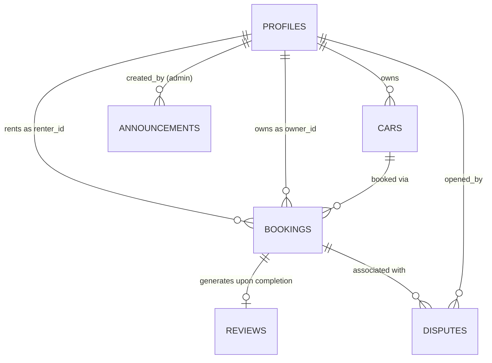

# Sheggar Wheels — Data Architecture & Storage Specification (`DATA.md`)

This document details the data architecture, relational schema, authoritative invariants, and browser storage migration for **Sheggar Wheels**, a peer-to-peer car rental marketplace in Addis Ababa, Ethiopia.

---

## 1. Architecture Overview: Single Source of Truth

The authoritative source of truth for all shared marketplace records is a **PostgreSQL relational database hosted via Supabase**. Browser storage (`localStorage` / `sessionStorage`) is reserved strictly for non-sensitive client UI state (such as temporary checkout drafts and interface preferences).



---

## 2. PostgreSQL Relational Schema

### 2.1 `profiles`
Extends `auth.users` to maintain marketplace profile attributes and authorization roles.

| Column | Type | Constraints | Description |
|---|---|---|---|
| `id` | `UUID` | `PRIMARY KEY`, `REFERENCES auth.users(id) ON DELETE CASCADE` | Associated Supabase Auth user ID |
| `name` | `TEXT` | `NOT NULL` | Full display name |
| `phone` | `TEXT` | `NULLABLE` | Contact telephone number |
| `roles` | `TEXT[]` | `NOT NULL`, `DEFAULT '{renter}'` | Array of assigned roles: `'renter'`, `'owner'`, `'admin'` |
| `status` | `TEXT` | `NOT NULL`, `DEFAULT 'active'`, `CHECK (status IN ('active', 'suspended'))` | Account moderation status |
| `created_at` | `TIMESTAMPTZ`| `NOT NULL`, `DEFAULT now()` | Record creation timestamp |
| `updated_at` | `TIMESTAMPTZ`| `NOT NULL`, `DEFAULT now()` | Record update timestamp |

> **Security Guardrail:** The `trigger_protect_profile_roles` database trigger prevents non-administrators from elevating their privileges to `'admin'` or lifting a suspended account status.

---

### 2.2 `cars`
Vehicle listings published by vehicle owners across Addis Ababa neighbourhoods.

| Column | Type | Constraints | Description |
|---|---|---|---|
| `id` | `UUID` | `PRIMARY KEY`, `DEFAULT gen_random_uuid()` | Unique vehicle identifier |
| `owner_id` | `UUID` | `NOT NULL`, `REFERENCES profiles(id) ON DELETE CASCADE` | Profile ID of the vehicle owner |
| `make` | `TEXT` | `NOT NULL` | Vehicle manufacturer (e.g., Toyota) |
| `model` | `TEXT` | `NOT NULL` | Vehicle model (e.g., Corolla) |
| `year` | `INTEGER` | `NOT NULL`, `CHECK (year BETWEEN 1990 AND 2100)` | Manufacturing year |
| `transmission` | `TEXT` | `NOT NULL`, `CHECK (transmission IN ('Automatic', 'Manual'))` | Gearbox configuration |
| `fuel` | `TEXT` | `NOT NULL`, `CHECK (fuel IN ('Petrol', 'Diesel', 'Hybrid', 'Electric'))` | Fuel type |
| `seats` | `INTEGER` | `NOT NULL`, `CHECK (seats BETWEEN 2 AND 50)` | Passenger seating capacity |
| `category` | `TEXT` | `NOT NULL` | Category (e.g., Economy, SUV, Van, Luxury) |
| `city` | `TEXT` | `NOT NULL`, `DEFAULT 'Addis Ababa'` | City location |
| `neighbourhood` | `TEXT` | `NOT NULL` | Addis Ababa sub-city/neighbourhood (e.g., Bole, CMC, Mexico) |
| `latitude` | `NUMERIC(9,6)` | `NULLABLE` | Seeded demo latitude |
| `longitude`| `NUMERIC(9,6)` | `NULLABLE` | Seeded demo longitude |
| `price_per_day`| `INTEGER` | `NOT NULL`, `CHECK (price_per_day > 0)` | Daily rental rate in Ethiopian Birr (ETB) |
| `photos` | `JSONB` | `NOT NULL`, `DEFAULT '{}'::jsonb` | Photo paths (`front`, `side`, `rear`) |
| `description` | `TEXT` | `NOT NULL` | Descriptive summary of vehicle |
| `status` | `TEXT` | `NOT NULL`, `DEFAULT 'pending'`, `CHECK (status IN ('pending', 'approved', 'rejected', 'inactive'))` | Moderation & listing availability status |
| `unavailable_dates` | `DATE[]` | `DEFAULT '{}'` | Array of owner-blocked dates |
| `created_at` | `TIMESTAMPTZ`| `NOT NULL`, `DEFAULT now()` | Timestamp |
| `updated_at` | `TIMESTAMPTZ`| `NOT NULL`, `DEFAULT now()` | Timestamp |

---

### 2.3 `bookings`
Core rental transaction linking a renter, a vehicle, and an owner for a specified date range.

| Column | Type | Constraints | Description |
|---|---|---|---|
| `id` | `UUID` | `PRIMARY KEY`, `DEFAULT gen_random_uuid()` | Unique booking identifier |
| `car_id` | `UUID` | `NOT NULL`, `REFERENCES cars(id) ON DELETE RESTRICT` | Booked vehicle ID |
| `renter_id` | `UUID` | `NOT NULL`, `REFERENCES profiles(id) ON DELETE RESTRICT` | Profile ID of customer |
| `owner_id` | `UUID` | `NOT NULL`, `REFERENCES profiles(id) ON DELETE RESTRICT` | Authoritative owner ID (enforced via trigger) |
| `start_date` | `DATE` | `NOT NULL` | Rental pickup date |
| `end_date` | `DATE` | `NOT NULL`, `CHECK (end_date > start_date)` | Rental return date |
| `days` | `INTEGER` | `NOT NULL`, `CHECK (days > 0)` | Calculated duration |
| `price_per_day` | `INTEGER` | `NOT NULL`, `CHECK (price_per_day > 0)` | Authoritative daily price snapshot at booking |
| `subtotal` | `INTEGER` | `NOT NULL`, `CHECK (subtotal >= 0)` | `days * price_per_day` |
| `platform_fee` | `INTEGER` | `NOT NULL`, `DEFAULT 0` | 10% demo platform commission |
| `total` | `INTEGER` | `NOT NULL`, `CHECK (total >= 0)` | Grand total (`subtotal + platform_fee`) in ETB |
| `payment_status` | `TEXT` | `NOT NULL`, `DEFAULT 'unpaid'`, `CHECK (payment_status IN ('unpaid', 'demo_paid', 'refunded'))` | Mock payment status |
| `status` | `TEXT` | `NOT NULL`, `DEFAULT 'requested'`, `CHECK (status IN ('requested', 'confirmed', 'in_progress', 'completed', 'reviewed', 'declined', 'cancelled', 'disputed', 'resolved'))` | FSM lifecycle state |
| `cancellation_reason` | `TEXT` | `NULLABLE` | Reason noted upon cancellation |
| `created_at` | `TIMESTAMPTZ`| `NOT NULL`, `DEFAULT now()` | Creation timestamp |
| `updated_at` | `TIMESTAMPTZ`| `NOT NULL`, `DEFAULT now()` | Update timestamp |

#### Authoritative Invariant 1: Concurrency-Safe Overlap Prevention
PostgreSQL `EXCLUDE` constraint with GiST index enforces that active bookings cannot overlap for the same vehicle:
```sql
ALTER TABLE public.bookings
  ADD CONSTRAINT no_overlapping_active_bookings
  EXCLUDE USING gist (
    car_id WITH =,
    daterange(start_date, end_date, '[)') WITH &&
  )
  WHERE (status IN ('requested', 'confirmed', 'in_progress'));
```
- **Interval Convention:** Half-open interval `[start_date, end_date)`. A booking ending on October 12 allows a subsequent booking starting on October 12.
- **Releasing Dates:** When a booking transitions to `declined`, `cancelled`, `completed`, `reviewed`, or `resolved`, it automatically drops out of the partial index, instantly making those dates available for other customers.

#### Authoritative Invariant 2: Price Snapshot & Financial Integrity
Client requests **never** dictate `price_per_day`, `owner_id`, `subtotal`, or `total`. The `trigger_prepare_booking` trigger on `bookings` reads the authoritative daily rate from `cars.price_per_day` at insertion time and computes `subtotal`, `platform_fee`, and `total` server-side.

---

### 2.4 `reviews`
Verified feedback submitted by renters following trip completion.

| Column | Type | Constraints | Description |
|---|---|---|---|
| `id` | `UUID` | `PRIMARY KEY`, `DEFAULT gen_random_uuid()` | Review identifier |
| `booking_id` | `UUID` | `NOT NULL`, `UNIQUE`, `REFERENCES bookings(id) ON DELETE CASCADE` | Guarantees exactly one review per booking |
| `car_id` | `UUID` | `NOT NULL`, `REFERENCES cars(id) ON DELETE CASCADE` | Reviewed vehicle |
| `renter_id` | `UUID` | `NOT NULL`, `REFERENCES profiles(id) ON DELETE CASCADE` | Verified renter |
| `owner_id` | `UUID` | `NOT NULL`, `REFERENCES profiles(id) ON DELETE CASCADE` | Car owner |
| `rating` | `INTEGER` | `NOT NULL`, `CHECK (rating BETWEEN 1 AND 5)` | Rating out of 5 stars |
| `comment` | `TEXT` | `NOT NULL`, `CHECK (char_length(comment) >= 8)` | Written review content |
| `owner_reply` | `TEXT` | `NULLABLE` | Optional public response from vehicle owner |
| `created_at` | `TIMESTAMPTZ`| `NOT NULL`, `DEFAULT now()` | Creation timestamp |

---

### 2.5 `disputes` & `announcements`
- `disputes`: Links a controversial booking to an administrative resolution log with timestamps, open/resolved state, and admin notes.
- `announcements`: Platform-wide messages published and deactivated exclusively by platform administrators.

---

## 3. Storage Keys & Migration Matrix

| Key | Original Storage Role | Database Architecture Status | Notes |
|---|---|---|---|
| `sw_cars_v1` | Authoritative car listings | **Replaced** by PostgreSQL `cars` table | Data served through Server Components and API queries. |
| `sw_users_v1` | Plaintext user accounts | **Replaced** by Supabase Auth (`auth.users`) and `profiles` | Password storage in browser storage completely eliminated. |
| `sw_bookings_v1` | Authoritative booking records | **Replaced** by PostgreSQL `bookings` table | Eliminates multi-tab desynchronization and race conditions. |
| `sw_reviews_v1` | Authoritative vehicle reviews | **Replaced** by PostgreSQL `reviews` table | Enforced with single-review uniqueness. |
| `sw_disputes_v1` | Unimplemented browser key | **Implemented** in PostgreSQL `disputes` table | Resolves brief requirement. |
| `sw_announcements_v1` | Unimplemented browser key | **Implemented** in PostgreSQL `announcements` table | Platform announcements with active toggle. |
| `sw_current_user_v1` | Local user session object | **Replaced** by Supabase Auth Session cookie | Handled securely via HTTP cookies. |
| `sw_checkout_draft_v1` | `sessionStorage` checkout state | **Retained** in `sessionStorage` | Temporary guest/draft dates held while completing sign-in. |
